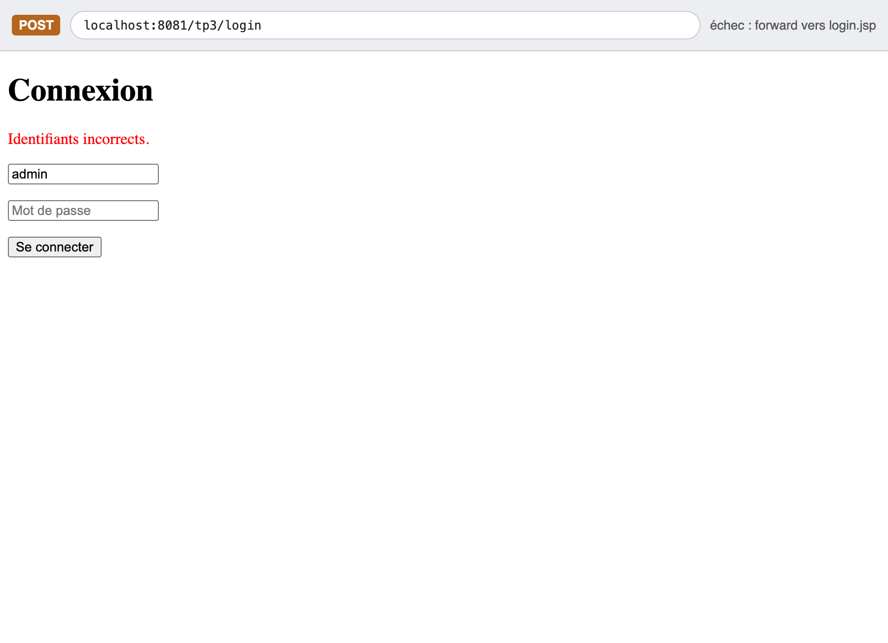
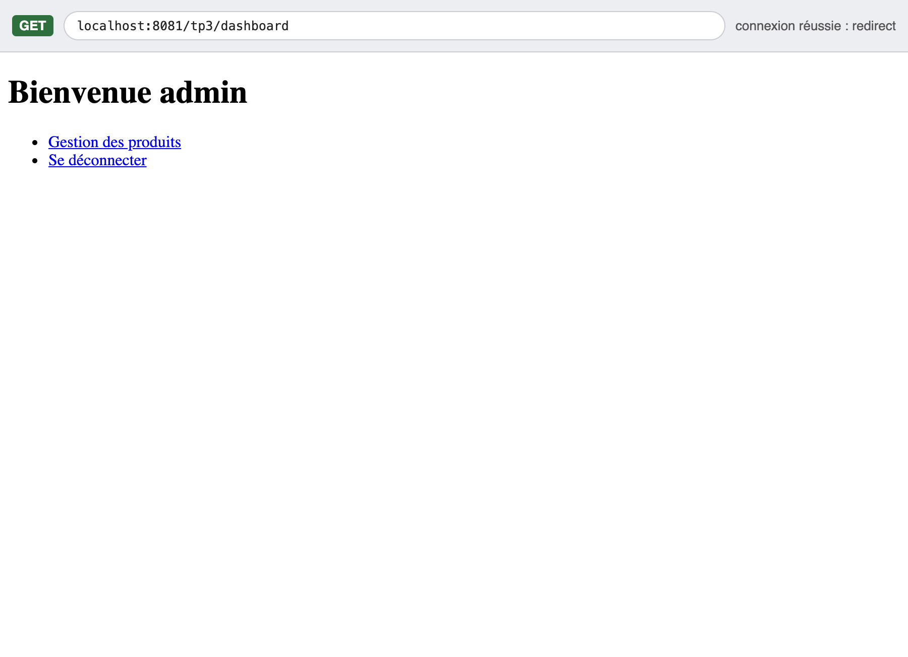
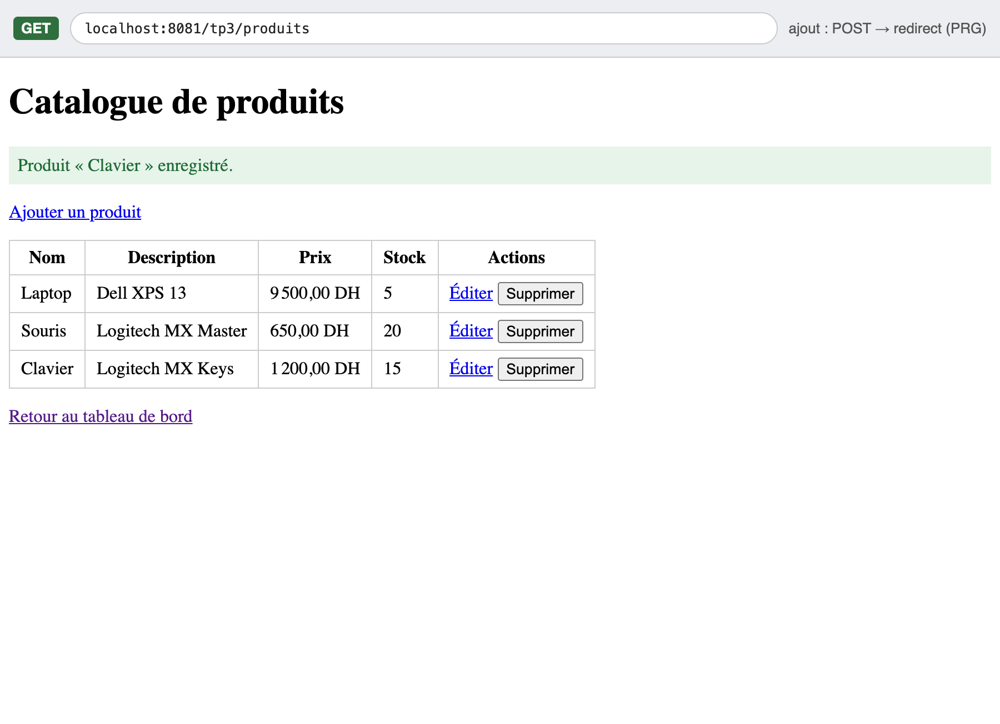
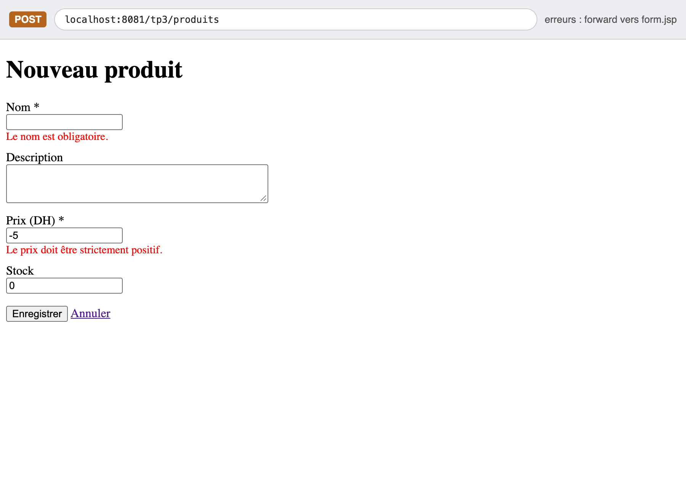
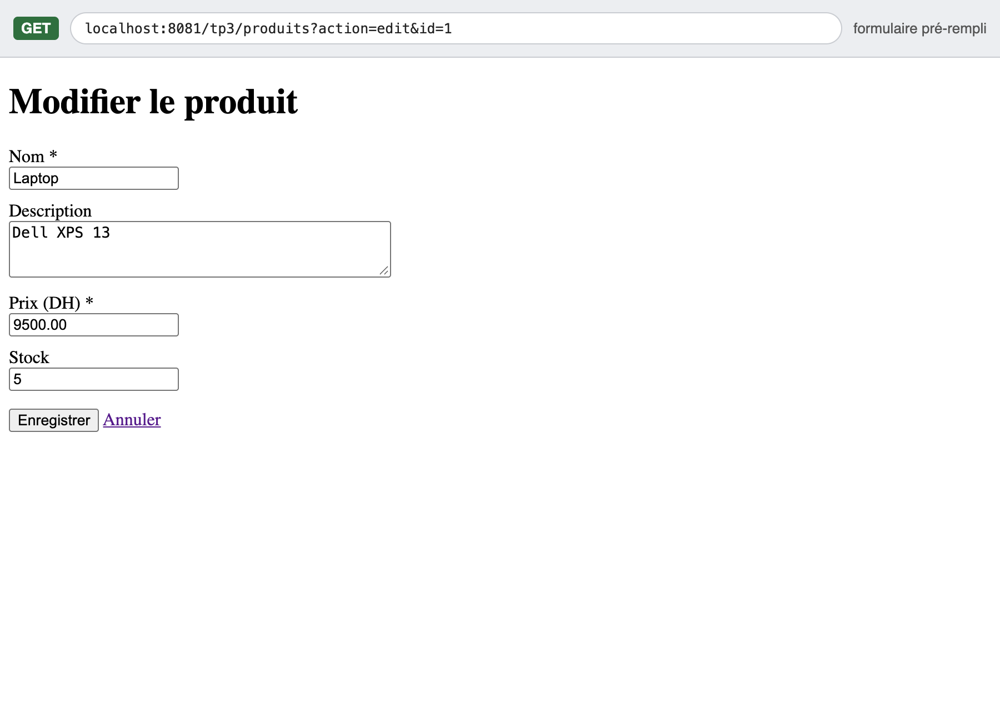
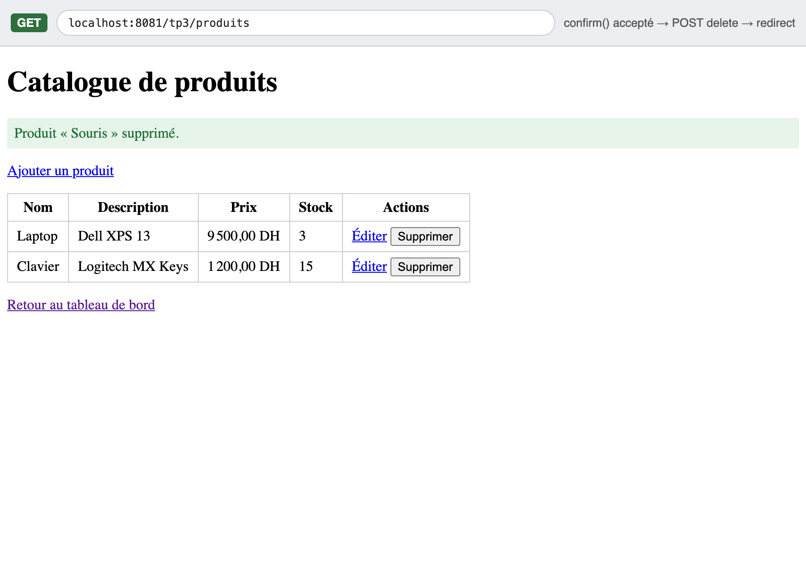
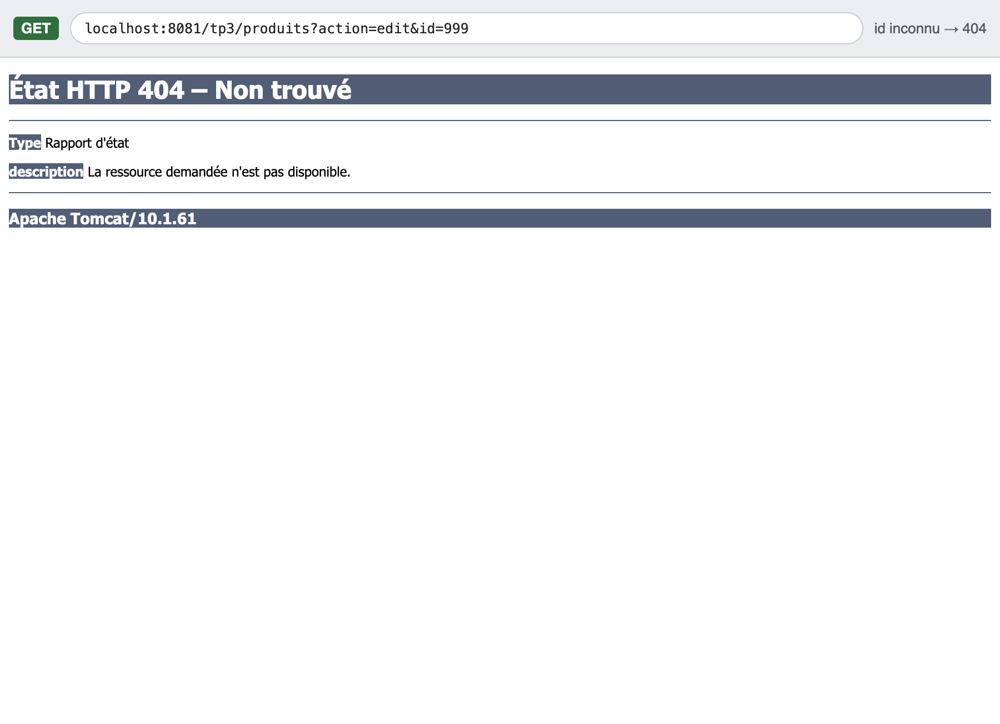
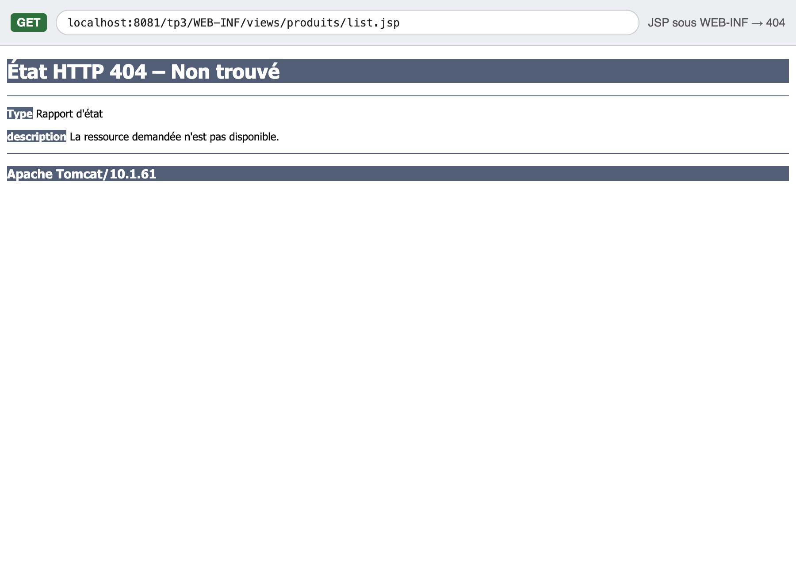
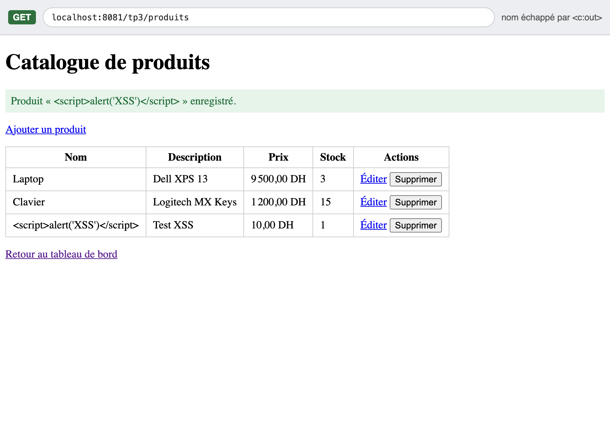

# TP 3 : Du Servlet au MVC

> ENIAD Berkane · GINF2 · Module JEE · Pr. Hayat Ouadi

Mini-site de gestion de produits (CRUD) en **MVC** : servlets comme contrôleurs, JSP (EL + JSTL)
comme vues, un DAO en mémoire comme modèle, et un filtre pour l'authentification.

Réponses aux questions du TP : **[REPONSES.md](REPONSES.md)**

**Stack :** Java 17 · Jakarta EE (Servlet 6.0, JSTL 3.0) · Tomcat 10.1 · Maven · Eclipse

## Structure

```
src/main/
├── java/ma/app/
│   ├── model/      Produit, ProduitDAO
│   ├── web/        LoginServlet, LogoutServlet, DashboardServlet, ProduitServlet
│   ├── filter/     AuthFilter
│   └── listener/   AppInitListener
└── webapp/WEB-INF/views/
    ├── login.jsp, dashboard.jsp
    └── produits/   list.jsp, form.jsp
```

```
Navigateur → AuthFilter → ProduitServlet → ProduitDAO → forward → list.jsp → HTML
```

## Lancer le projet

- **Eclipse :** *Run As → Run on Server* → Tomcat 10.1
- **Maven :** `mvn clean package`, puis copier `target/tp3-1.0.war` dans `webapps/` de Tomcat sous le nom `tp3.war`

Ouvrir <http://localhost:8080/tp3/login> · identifiants : `admin` / `password`

## Routes

| Méthode | URL | Réponse |
|---|---|---|
| GET / POST | `/login` | formulaire · succès → redirect `/dashboard`, échec → forward avec erreur |
| GET | `/logout` | redirect `/login` |
| GET | `/dashboard` | `dashboard.jsp` |
| GET | `/produits` | liste |
| GET | `/produits?action=new` | formulaire vide |
| GET | `/produits?action=edit&id=3` | formulaire pré-rempli (404 si id inconnu) |
| POST | `/produits` | créer / modifier → redirect `/produits`, sinon formulaire avec erreurs |
| POST | `/produits?action=delete` | supprimer → redirect `/produits` |

## Tests

| # | Test | Résultat |
|---|---|---|
| 1 | `/produits` sans être connecté → `/login` | ✅ |
| 2 | Mauvais mot de passe → erreur, login conservé | ✅ |
| 3 | `admin` / `password` → tableau de bord | ✅ |
| 4 | Ajout valide → liste + message flash | ✅ |
| 5 | Prix `-5` et nom vide → deux erreurs | ✅ |
| 6 | Modification → champs pré-remplis, changement visible | ✅ |
| 7 | Suppression → confirmation puis disparition | ✅ |
| 8 | `/produits?action=edit&id=999` → 404 | ✅ |
| 9 | `/WEB-INF/views/produits/list.jsp` → 404 | ✅ |
| 10 | Déconnexion puis `/dashboard` → `/login` | ✅ |

## Checklist

- [x] Aucun `getWriter().println` de HTML dans les servlets
- [x] JSP sous `WEB-INF/views`, sans scriptlet
- [x] Aucun chemin `/app/...` en dur
- [x] DAO unique créé par le listener (`ServletContext`)
- [x] Erreurs de validation affichées dans le formulaire
- [x] PRG après chaque POST réussi
- [x] Suppression en POST
- [x] Filtre `AuthFilter` opérationnel
- [x] 4 questions répondues dans [REPONSES.md](REPONSES.md)

## Captures d'écran

| | |
|---|---|
|  Échec de connexion |  Tableau de bord |
|  Ajout + message flash |  Erreurs de validation |
|  Modification |  Suppression |
|  Id inconnu → 404 |  JSP sous WEB-INF → 404 |
|  XSS échappé par `<c:out>` | |
