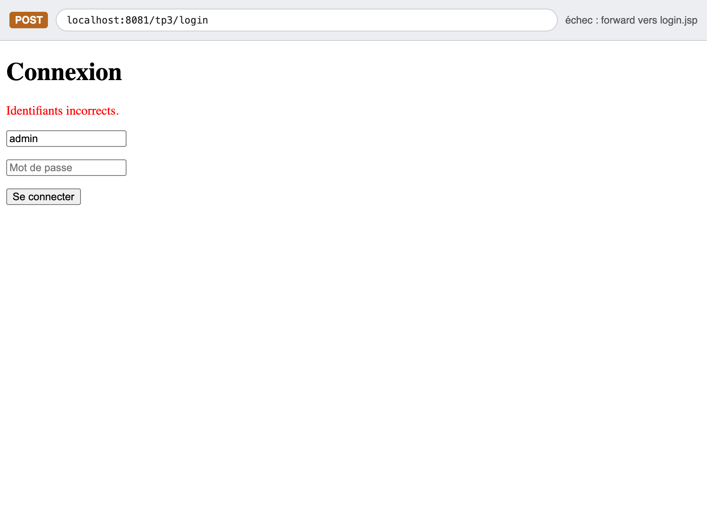
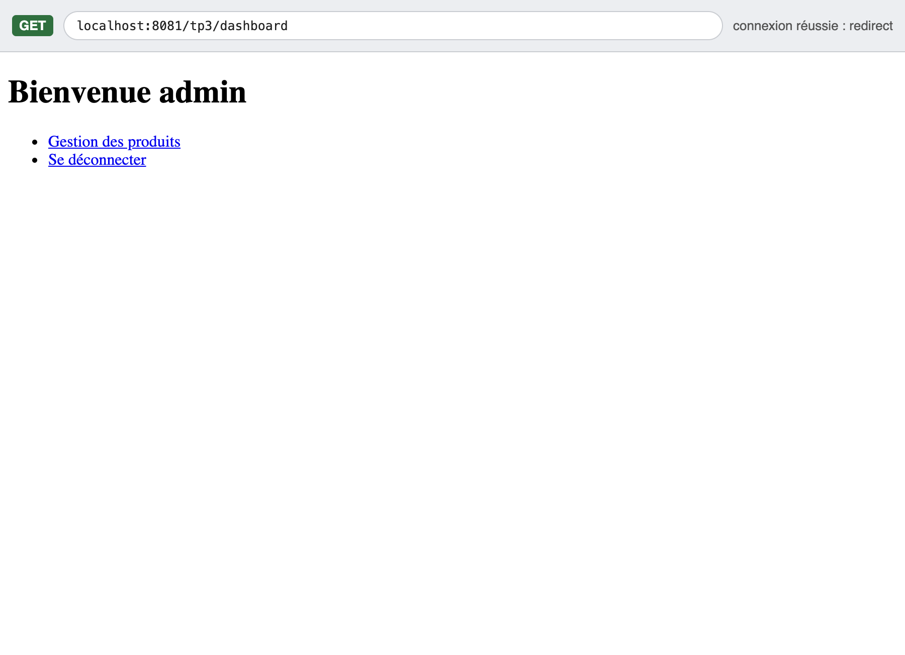
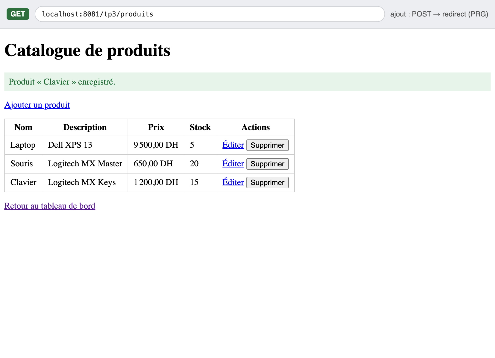
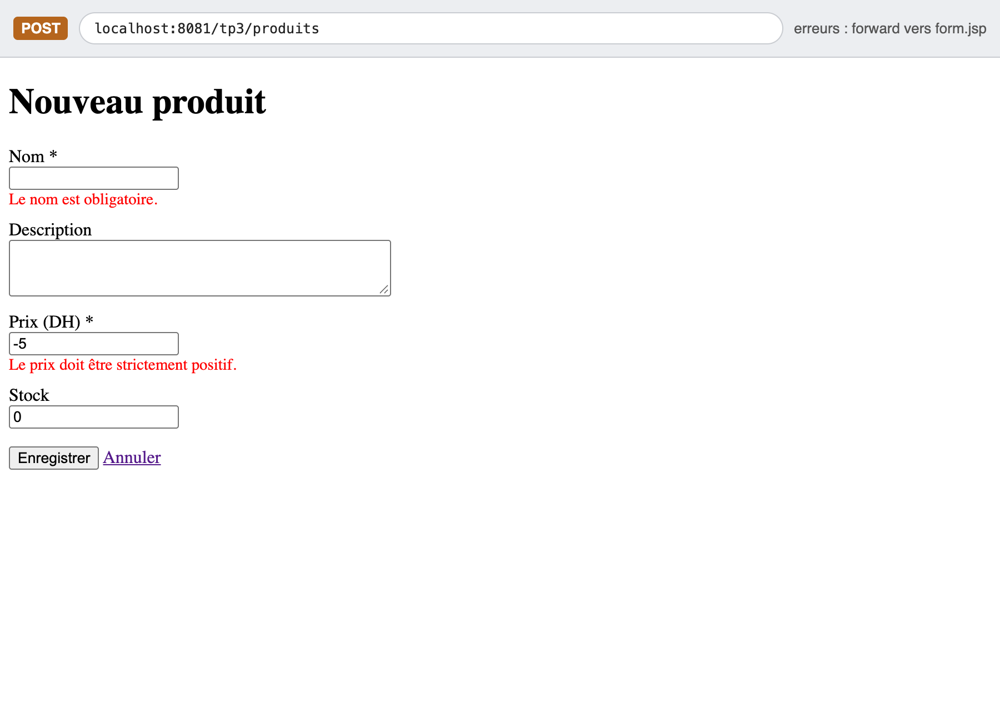
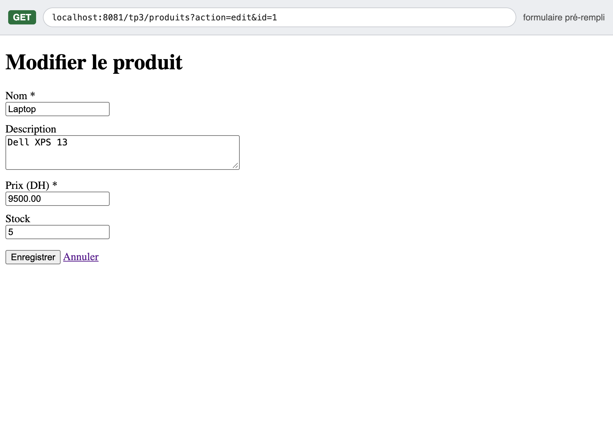
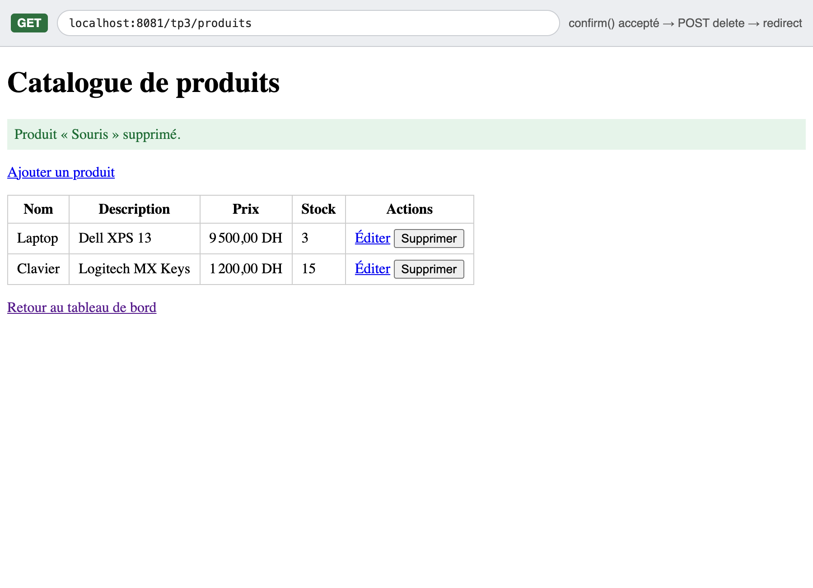
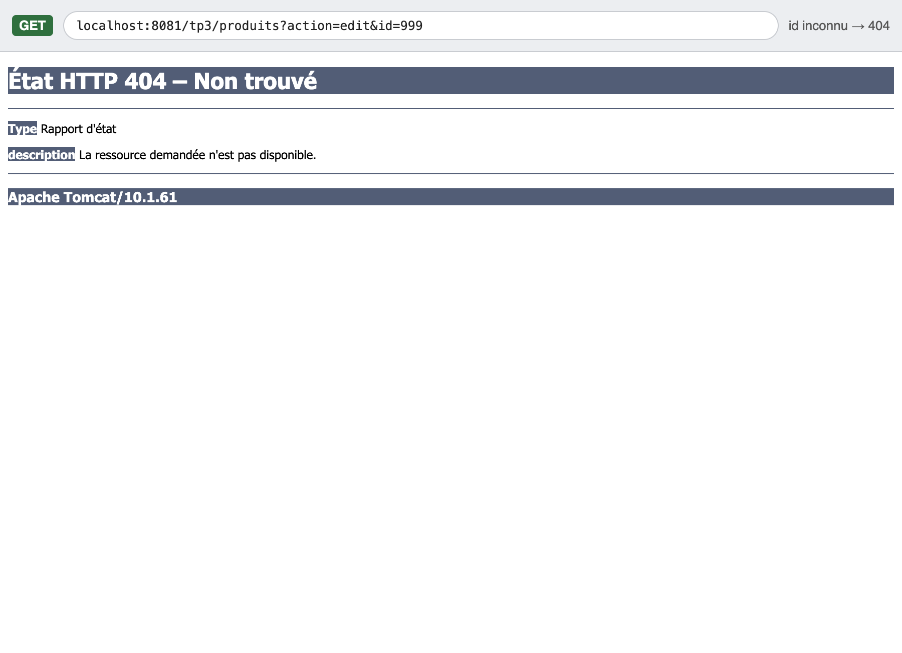
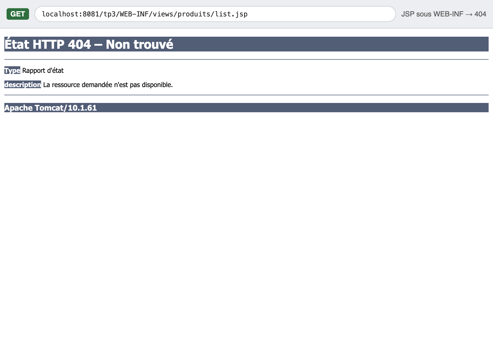
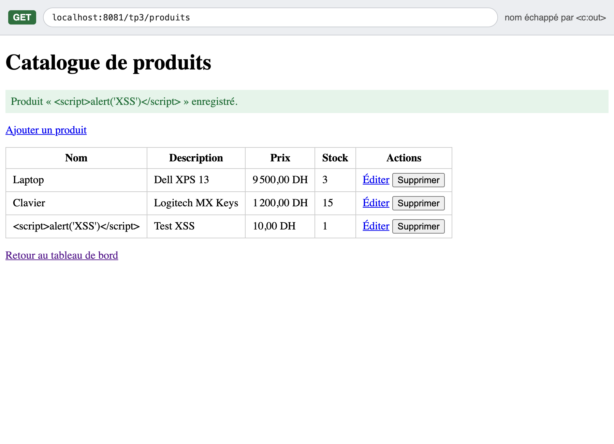

# TP 3 : Du Servlet au MVC — Mini-site de gestion de produits

> Université Mohammed Premier · ENIAD Berkane · GINF2 · Module JEE · Pr. Hayat Ouadi

Application web Jakarta EE qui reprend le projet du TP 2 et le restructure selon le pattern
**MVC (Modèle – Vue – Contrôleur)** : les servlets ne produisent plus de HTML, elles délèguent
l'affichage à des **vues JSP (EL + JSTL)**. Le projet ajoute un module **CRUD de produits**
réservé aux utilisateurs connectés, protégé par un **filtre d'authentification**.

Les réponses aux 4 questions du TP sont dans **[REPONSES.md](REPONSES.md)**.

---

## Technologies

| Outil | Version |
|---|---|
| Java | 17 (OpenJDK Homebrew) |
| Jakarta Servlet API | 6.0 (`jakarta.*`) |
| JSP + JSTL | JSTL 3.0 (implémentation GlassFish 3.0.1) |
| Serveur | Apache Tomcat 10.1 (testé avec 10.1.61) |
| Build | Maven (packaging `war`) |
| IDE | Eclipse IDE for Enterprise Java (macOS) |

---

## Architecture

```
tp3/
├── pom.xml
├── README.md
├── REPONSES.md
├── docs/screenshots/                 (captures d'écran)
└── src/main/
    ├── java/ma/app/
    │   ├── model/
    │   │   ├── Produit.java          (Modèle : entité)
    │   │   └── ProduitDAO.java       (Modèle : accès aux données, Map en mémoire thread-safe)
    │   ├── web/
    │   │   ├── LoginServlet.java     (Contrôleur : /login)
    │   │   ├── LogoutServlet.java    (Contrôleur : /logout)
    │   │   ├── DashboardServlet.java (Contrôleur : /dashboard)
    │   │   └── ProduitServlet.java   (Contrôleur : /produits, CRUD complet)
    │   ├── filter/
    │   │   └── AuthFilter.java       (contrôle d'accès centralisé)
    │   └── listener/
    │       └── AppInitListener.java  (création du DAO unique au démarrage)
    └── webapp/
        ├── index.html
        └── WEB-INF/
            ├── web.xml
            └── views/
                ├── login.jsp
                ├── dashboard.jsp
                └── produits/
                    ├── list.jsp
                    └── form.jsp
```

### Rôle de chaque couche

- **Modèle** (`ma.app.model`) : `Produit` (entité) et `ProduitDAO`, qui stocke les produits dans une
  `ConcurrentHashMap` avec un `AtomicLong` pour générer les identifiants (thread-safe, car une seule
  instance de servlet traite plusieurs requêtes en parallèle). Aucune dépendance à `jakarta.servlet`.
- **Listener** : `AppInitListener` (`@WebListener`) crée **un seul** `ProduitDAO` au démarrage et le
  range dans le `ServletContext` sous le nom `produitDAO` ; `ProduitServlet` le récupère dans `init()`.
- **Contrôleurs** (`ma.app.web`) : lisent les paramètres, appellent le DAO, placent les données en
  attributs de requête puis font un `forward` vers la vue (ou un `redirect` après un POST réussi).
- **Filtre** : `AuthFilter` (`@WebFilter` sur `/dashboard`, `/produits`, `/produits/*`) redirige vers
  `/login` si la session ne contient pas l'attribut `user`.
- **Vues** : JSP placées sous `WEB-INF/views` (inaccessibles directement depuis le navigateur),
  écrites uniquement avec EL et JSTL — **aucun scriptlet**.

### Cycle d'une requête

```
Navigateur ──► AuthFilter ──► ProduitServlet (Contrôleur)
                                   │ 1. lit les paramètres
                                   │ 2. appelle ProduitDAO (Modèle)
                                   │ 3. req.setAttribute("produits", …)
                                   ▼
                  forward ──► /WEB-INF/views/produits/list.jsp (Vue)
                                   │
Navigateur ◄────────── HTML ───────┘
```

---

## Lancer le projet

### Option 1 — Eclipse + Tomcat 10.1

1. *File → Import → Maven → Existing Maven Projects* et sélectionner le dossier `tp3`.
2. Ajouter un serveur **Apache Tomcat v10.1** dans la vue *Servers* (si ce n'est pas déjà fait).
3. Clic droit sur le projet → *Run As → Run on Server* → Tomcat v10.1.
4. Ouvrir <http://localhost:8080/tp3/login>.

### Option 2 — Maven en ligne de commande

```bash
mvn clean package
```

Le WAR est généré dans `target/tp3-1.0.war`. Pour garder le contexte `/tp3`, le copier sous le nom
`tp3.war` dans le dossier `webapps` de Tomcat (le nom du fichier détermine le chemin de contexte) :

```bash
cp target/tp3-1.0.war "$CATALINA_HOME/webapps/tp3.war"
```

```bash
"$CATALINA_HOME/bin/startup.sh"
```

Puis ouvrir <http://localhost:8080/tp3/login>.

### Identifiants

| Utilisateur | Mot de passe |
|---|---|
| `admin` | `password` |

Identifiants codés en dur, comme demandé par l'énoncé (repris du TP 2).

---

## Routes

| Méthode | URL | Action | Réponse |
|---|---|---|---|
| GET | `/login` | Afficher le formulaire de connexion | `forward` `login.jsp` (ou `redirect` `/dashboard` si déjà connecté) |
| POST | `/login` | Authentifier l'utilisateur | Succès : `user` en session + `redirect` `/dashboard` · Échec : `forward` `login.jsp` avec erreur et login conservé |
| GET | `/logout` | Invalider la session | `redirect` `/login` |
| GET | `/dashboard` | Tableau de bord (protégé) | `forward` `dashboard.jsp` |
| GET | `/produits` | Lister les produits (protégé) | `forward` `list.jsp` |
| GET | `/produits?action=new` | Formulaire vide | `forward` `form.jsp` |
| GET | `/produits?action=edit&id=3` | Formulaire pré-rempli | `forward` `form.jsp` (ou **404** si id inconnu) |
| POST | `/produits` | Créer (sans `id`) / modifier (avec `id` caché) | `redirect` `/produits` + message flash si OK, sinon `forward` `form.jsp` avec erreurs |
| POST | `/produits?action=delete` | Supprimer (`id` en champ caché + `confirm()`) | `redirect` `/produits` + message flash |

### Comportements clés

- **Forward vs redirect** : `forward` quand le login échoue (on garde l'erreur et le login saisi),
  `redirect` quand il réussit.
- **PRG (Post/Redirect/Get)** après chaque POST réussi : F5 ne renvoie jamais le formulaire.
- **Message flash** : stocké en session après création / modification / suppression, affiché **une
  seule fois** sur la liste puis supprimé (`<c:remove>`).
- **Suppression en POST** uniquement (mini-formulaire avec champ caché `id` et `confirm()`), jamais via
  un lien GET.
- **Validation** côté serveur dans une `Map<String, String>` ; le formulaire est ré-affiché avec les
  valeurs saisies et un message **sous chaque champ fautif** :
  - `nom` : obligatoire, 2 à 50 caractères
  - `prix` : obligatoire, nombre décimal strictement positif (la virgule est acceptée)
  - `stock` : entier ≥ 0 (vide = 0)
  - `description` : facultative, 255 caractères maximum
- **Sécurité** : toutes les valeurs affichées sont échappées avec `<c:out>` ou `${fn:escapeXml(...)}`
  (protection XSS) ; identifiant de session régénéré à la connexion (`changeSessionId()`) ; les JSP
  sous `WEB-INF` ne sont pas accessibles directement (404).

---

## Tests réalisés

| # | Test | Résultat attendu | Résultat |
|---|---|---|---|
| 1 | Accéder à `/produits` sans être connecté | Redirection vers `/login` | ✅ OK |
| 2 | Se connecter avec un mauvais mot de passe | Message d'erreur, login conservé | ✅ OK |
| 3 | Se connecter avec `admin` / `password` | Tableau de bord | ✅ OK |
| 4 | Ajouter un produit valide | Retour à la liste avec message flash | ✅ OK |
| 5 | Soumettre un prix `-5` et un nom vide | Formulaire ré-affiché avec les deux erreurs | ✅ OK |
| 6 | Modifier un produit | Champs pré-remplis, modification visible | ✅ OK |
| 7 | Supprimer un produit | Confirmation puis disparition de la liste | ✅ OK |
| 8 | Accéder à `/produits?action=edit&id=999` | Erreur 404 | ✅ OK |
| 9 | Taper l'URL `/WEB-INF/views/produits/list.jsp` | Erreur 404 | ✅ OK |
| 10 | Se déconnecter puis revenir sur `/dashboard` | Redirection vers `/login` | ✅ OK |

---

## Checklist du TP

- [x] Plus aucun `getWriter().println` de HTML dans les servlets
- [x] Toutes les JSP sont sous `WEB-INF/views` et ne contiennent aucun scriptlet
- [x] Aucun chemin `/app/...` écrit en dur (`req.getContextPath()` et `${pageContext.request.contextPath}`)
- [x] DAO unique créé par le listener et partagé via le `ServletContext`
- [x] Validation avec erreurs affichées dans le formulaire
- [x] Pattern PRG appliqué après chaque POST réussi
- [x] Suppression en POST
- [x] Filtre `AuthFilter` opérationnel
- [x] Les 4 questions sont répondues dans un fichier [REPONSES.md](REPONSES.md)

---

## Captures d'écran

> Captures réalisées sur une instance Tomcat 10.1.61 locale lancée sur le port 8081 (le port 8080
> étant occupé par le serveur d'Eclipse). Le bandeau gris en haut de chaque image indique la méthode
> HTTP et l'URL réellement affichée par le navigateur.

### 1. Échec de connexion (message d'erreur, login conservé)


### 2. Tableau de bord


### 3. Liste des produits avec message flash


### 4. Formulaire avec erreurs de validation


### 5. Modification d'un produit (champs pré-remplis)


### 6. Suppression (après confirmation `confirm()` « Supprimer ce produit ? »)


### 7. Produit inexistant : `/produits?action=edit&id=999` → 404


### 8. Accès direct à une JSP sous `WEB-INF` → 404


### 9. Tentative XSS affichée comme du texte grâce à `<c:out>`

